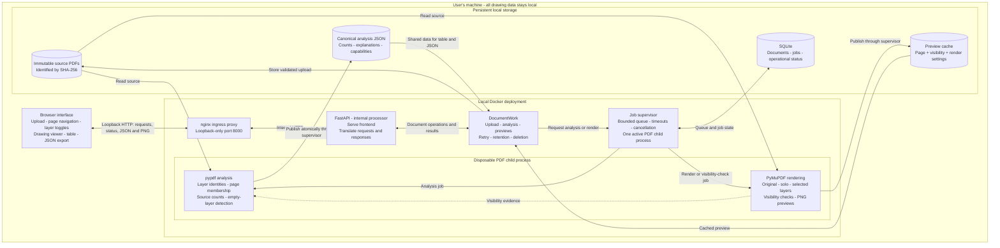

# CAD Layer Explorer

A local PDF layer inspector with a plain HTML/CSS/JavaScript frontend, FastAPI, pypdf, PyMuPDF, and SQLite. No frontend build step or remote document service.

Start from PowerShell with Docker Desktop running:

```powershell
docker compose up --build -d --wait
```

Open **http://127.0.0.1:8000** and choose **Open PDF**. Upload progress is followed by source inspection and visibility measurement. Browse pages, search layers, choose **Solo**, or combine layer switches. The evidence table, details, JSON view, and full JSON download use the same canonical manifest. Duplicate names remain separate objects.

**Original** restores the PDF's default visibility. **All on/off** control native layers. Unlayered base content remains visible; documents containing base or conditional content cannot claim strict solo. Annotation overlays are off by default. **Fit page**, zoom, scroll, and drag support drawing inspection; zoom requests a sharper render within the pixel budget.

Reopen retained drawings from the sidebar. Delete removes the application's source copy, analysis, previews, and jobs, including in-flight work; it leaves your original file untouched.

```powershell
docker compose stop
docker compose start --wait
docker compose logs --tail 50 app
```

Data lives in the Docker-managed `cad-data` volume. Stopping or rebuilding preserves it. Do not remove the volume unless you intend to delete all retained drawings. The supplied private PDF is excluded from the Docker build context and image.

The `app` processor runs as an unprivileged user on an **internal Docker network with no external route**. A small nginx `web` container exposes only `127.0.0.1:8000` and proxies requests to the processor. This separate ingress is necessary because the installed Docker engine does not publish ports from internal-only containers. All browser assets are local; the UI applies a same-origin content security policy. Installation/build downloads dependencies; runtime processing needs no internet.

The worker supervisor runs one disposable PDF child at a time, queues up to eight jobs, and terminates/reaps timed-out children. Linux workers have an OS address-space limit plus aggregate memory monitoring; Docker also caps the processor container at 1.5 GiB. Defaults: 100 MiB upload, 200 pages, four million render pixels, 15-second render / 300-second analysis timeout, 1 GiB child memory, nesting 32, decoded stream/document limits 32/256 MiB, and 512 MiB LRU preview cache. Sources and manifests are not evicted. Active limits are exposed at `/api/health`. Override `CAD_*` environment variables from [app/settings.py](app/settings.py) in Compose; adjust nginx's request cap if increasing upload size.

Unsupported configurations, conditional memberships, and unreliable text decoding are disclosed. Source-operation counts are not CAD entity counts or engineering interpretations. Bounds are currently unavailable. Visibility measurements use RGB, white background, annotations off, 36 DPI; invisible pixels do not prove source emptiness. PyMuPDF is AGPL/commercial; its licensing was accepted for this task.

Development on Windows (Python 3.12 and uv):

```powershell
uv sync --frozen
uv run uvicorn app.main:app --host 127.0.0.1 --port 8000 --reload
```

The frontend is served directly from `app/static`. Native Windows development uses memory monitoring; the OS-enforced resource acceptance target is the Linux Docker runtime. Operational state is separate from canonical analysis, successful results publish atomically, incompatible analyzer/engine profiles require reanalysis, and restart marks unfinished jobs interrupted with an explicit retry.

The backend uses composition: [DocumentWork](app/document_work.py) owns complete document operations, [JobSupervisor](app/jobs.py) owns bounded execution, and [Repository](app/repository.py) owns persistence. FastAPI handlers translate HTTP requests and responses without coordinating storage locks, paths, or child processes. PDF interpretation and rendering have their own focused objects in [the PDF module](app/pdf.py).

[Shared typed models](app/models.py) describe manifests, requests, worker messages, progress, errors, and persisted records. JSON and SQLite inputs are validated at those seams. Strict mypy checks the entire backend; the untyped PyMuPDF dependency has a narrow [protocol declaration](app/pdf_engine.py), rather than propagating unchecked values through the application.

```powershell
uv run mypy
uv run mypy --platform linux
uv run pytest -q tests/test_backend_regressions.py
uv run python tests/browser_review.py
```

The backend regressions use temporary storage and real child processes. The isolated frontend regressions use controlled responses to reproduce document-switch and stale-error races; they complement the full application checks below.

Post-implementation verification against the running Docker app:

```powershell
uv run pytest -q tests/test_app.py
uv run playwright install chromium
uv run python tests/browser_acceptance.py
$env:CAD_FULL_ACCEPTANCE = '1'
uv run pytest -q tests/test_app.py -k supplied_drawing
```

The last command requests all 495 supplied page-layer pairs and 38 all-off pages through uncached render jobs; allow several minutes. Synthetic fixtures cover counts, repeated Forms, images, shadings, hidden/unused/empty groups, base and conditional content, scans, annotations, rotated crops, invalid inputs, deletion, deduplication, and independent deterministic reanalysis. Browser screenshots and private artifacts stay under ignored `tmp/acceptance`. See [verification notes](docs/verification.md) for actual results and limits of the acceptance evidence.

Set `CAD_TEST_URL` to test a separate local deployment and `CAD_EVIDENCE_DIR` to give the browser runner a separate evidence directory. Analyzer 1.4.0 invalidates earlier manifests after corrections to inherited font handling and supported rendering modes; retained originals can be reanalyzed locally.

A local web app for exploring native layers in CAD-exported PDFs. Upload a drawing, inspect its layers and content counts, view layers independently, and export the analysis as JSON. All drawing data stays on your machine.

## Architecture

The browser uses plain HTML, CSS, and JavaScript. FastAPI serves the interface and API, while a supervised PDF process handles analysis and rendering inside the local application container.



The canonical manifest supplies both the table and JSON export. Layer identities use the document hash and PDF object reference, so duplicate names remain distinct. Source emptiness and visible output are measured separately.

PDF work runs outside the API process with bounded resources. Original PDFs and completed analyses persist until deletion; previews are cached and can be regenerated.
