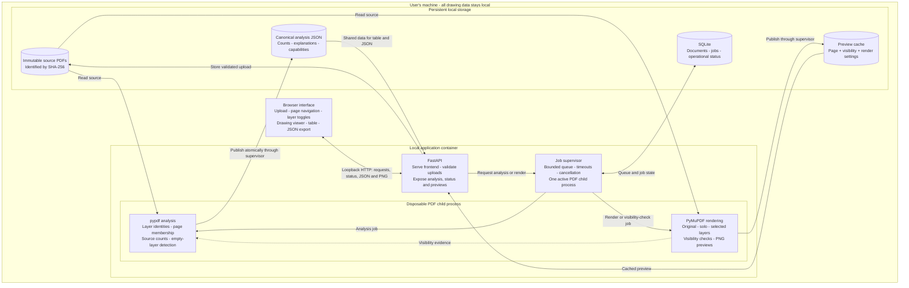

# CAD-Layer-Explorer

A local web app for exploring native layers in CAD-exported PDFs. Upload a drawing, inspect its layers and content counts, view layers independently, and export the analysis as JSON. All drawing data stays on your machine.

## Architecture

The browser uses plain HTML, CSS, and JavaScript. FastAPI serves the interface and API, while a supervised PDF process handles analysis and rendering inside the local application container.

The canonical manifest supplies both the table and JSON export. Layer identities use the document hash and PDF object reference, so duplicate names remain distinct. Source emptiness and visible output are measured separately.

PDF work runs outside the API process with bounded resources. Original PDFs and completed analyses persist until deletion; previews are cached and can be regenerated.
